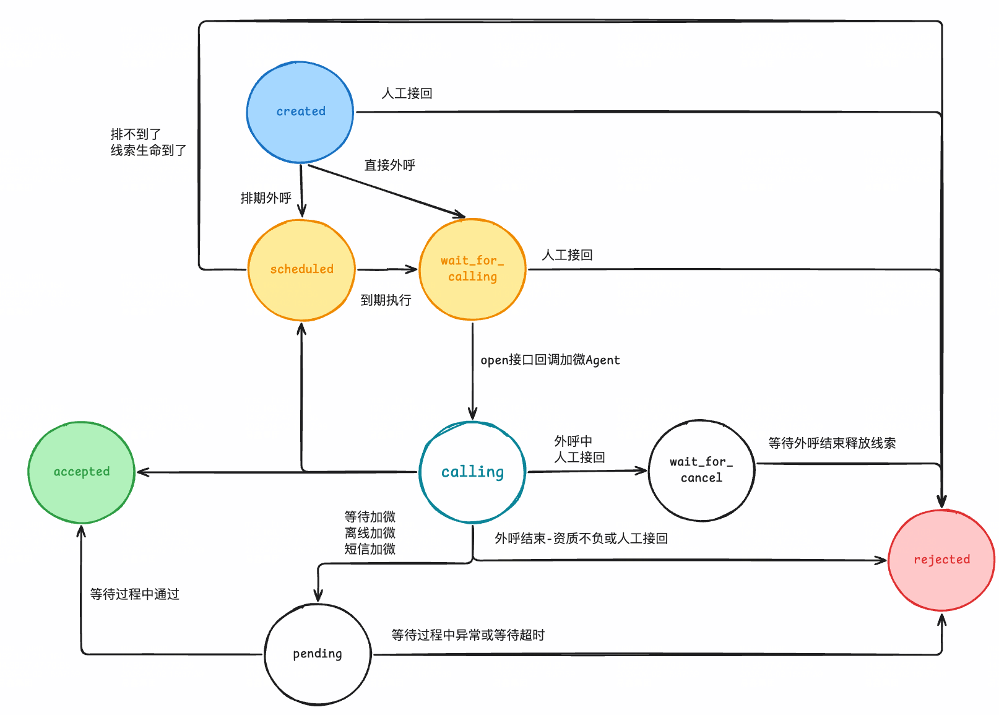
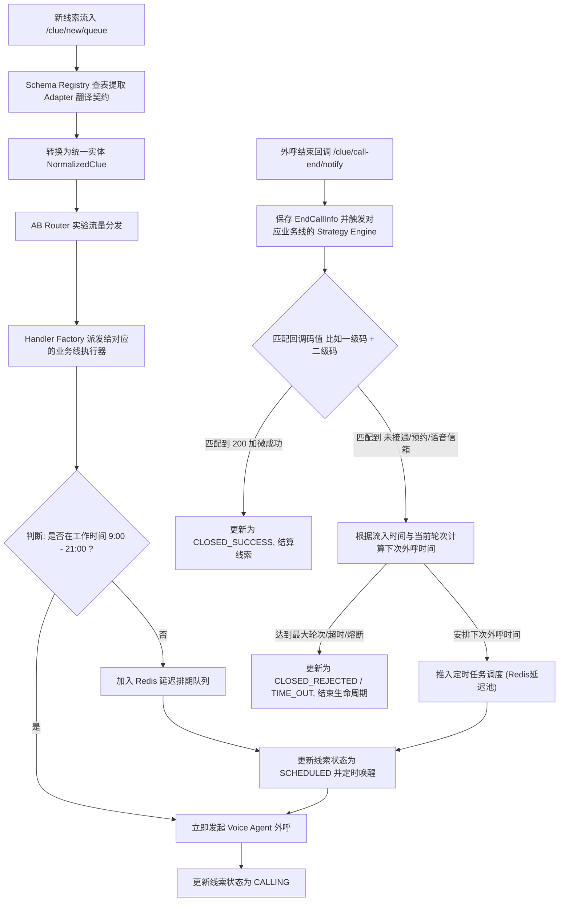

# Agentic WeChat Agent (智能外呼及微信线索跟进系统)

商业化线索受理接口见 [docs/CLUE_INFLOW.md](docs/CLUE_INFLOW.md)。独立Redis呼叫排期和原生话务送号见 [docs/CALL_SCHEDULING.md](docs/CALL_SCHEDULING.md)；新流入生成持久呼叫任务，由独立worker到期处理。Agent配置读取按要求暂留 [TODO](docs/TODO_TELEPHONY.md)，缺少配置时任务保持待处理。以下为项目原有能力说明。



通话总结模块支持完整通话的前处理、按需模型分析和业务三态，`summary_type` 与 `summary_prompt` 独立配置，并提供按 `call_id` 保存结果的接口。handler 调用和排期接入待后续完成，见 [模块说明](project/app/summary/README.md)。

本项目是一个基于 Python FastAPI 构建的智能外呼与微信线索跟进助手（**Agentic WeChat Agent**）。系统旨在处理从上游推入的销售线索，依据预设的智能外呼与次呼重试算法，联动 AI 语音电话外呼平台（Voice Agent）以及微信通道（WeChat Channel），自动完成“电话联系 -> 微信添加 -> 状态追踪 -> 数据结算”的完整业务闭环。

---

## 🌟 核心特性

- **多业务线“插拔式”架构 (全新重构)**：
  - **Schema-Less 弹性网关**：边缘网关和数据库抛弃了强耦合的臃肿请求体。只需传入核心路由骨架字段，其余所有上游私有业务参数通过 `payload` 自动装载，互不干扰。
  - **动态服务定位 (Registry & Adapter)**：采用依赖查找和适配器模式。路由层无需硬编码，自动去 `schema_registry` 中查表，将各种上游报文翻译成系统内部标准的 `NormalizedClue`。
  - **工厂与模板方法模式**：基于 `Handler Factory` 将线索分发至各业务线的专属执行器；拨打排期的算命逻辑被下沉至 `BaseStrategyEngine` 模板中，新业务只需改配置即可复用整个外呼大脑。
- **智能次呼排期引擎**：
  - 精准的工作时间窗口限制（默认 09:00 - 21:00），非工作时间自动延期。
  - **流入时间分段策略**：根据线索流入的具体时段（工作时间、夜间 21:00+、凌晨 0-6 点、清晨 6-9 点）和呼叫轮次（第 1 至 7 轮），动态计算最佳的下次拨打时间。
  - **最大时效约束**：线索在系统内生命周期最多为 48 小时，超时自动终结。
  - **未接通阈值保护**：支持连续未接通次数（最多 4 次）或距离流入时间未接通小时数（最多 26 小时）熔断。
- **可靠的异步队列**：
  - 基于 Redis 实现线索消息队列，支持单机 Redis 及 Redis 集群（Redis Cluster）的自动解析与健康检查。
  - 支持后台多任务 Worker 自动消费，确保在高吞吐量线索推送下的系统高可用性。
- **严谨的状态机流转**：
  - 定义了清晰的线索状态（如 `INIT`, `CALLING`, `SCHEDULED`, `ACCEPTED`, `REJECTED`, `CLOSED_SUCCESS` 等）。
  - 使用 SQLite 和轻量级 Tortoise ORM 异步读写线索记录、状态与外呼结束话务详情。
- **微信状态闭环联动**：对接外部微信通道与加微事件，匹配多种业务码值（例如 200 加微成功、离线加微等）并触发对应动作。

---

## 📂 项目结构

```text
agentic_wechat_agent/
├── README.md               # 本说明文档
└── project/
    ├── app/
    │   ├── __init__.py
    │   ├── main.py         # 应用程序入口，初始化数据库/Redis并启动后台消费Worker
    │   ├── config.py       # 配置文件（包含数据库URL、外部API端点及Redis配置）
    │   ├── apis/           # 外部接口对接服务 (Voice Agent, 微信等)
    │   │   ├── access_schedule.py  # 调度任务回传
    │   │   ├── access_sync.py      # 线索状态同步回传
    │   │   ├── voice_agent.py      # 触发AI语音通话及清洗
    │   │   └── wechat_channel.py   # 微信渠道API调用
    │   ├── routers/        # FastAPI 路由层
    │   │   ├── clue_webhook.py    # 【网关层】系统大门，接收线索，查询 Registry 并分发
    │   │   └── database.py        # 数据库管理及大盘控制路由
    │   ├── business_routing/      # 【核心调度层】多业务线解耦路由
    │   │   ├── schema_registry.py # 绑定业务线与 Adapter 的中介注册表
    │   │   ├── clue_adapters.py   # 适配器，将外部 JSON 翻译为 NormalizedClue
    │   │   ├── ab_router.py       # 流量层，负责实验分流与兜底打散
    │   │   ├── handler_factory.py # 工厂，根据业务线分发给对应的 Handler
    │   │   └── normalized_clue.py # 系统内部流通的标准化线索模型
    │   ├── clue_handler/   # 线索消费与事件处理器
    │   │   ├── clue.py            # 各业务线的 Handler 实体（如 MockV1Handler）
    │   │   └── state.py           # 轻量状态枚举
    │   ├── strategy/       # 拨打策略与回调决策池
    │   │   ├── action_base.py     # 策略引擎基类（模板方法），负责算命排期逻辑
    │   │   ├── action.py          # V1 策略引擎实现
    │   │   ├── action_v2.py       # V2 策略引擎实现
    │   │   └── strategy_config.py # 策略核心参数结构体
    │   ├── dbmodels/       # 数据库与ORM定义
    │   │   ├── models.py          # 关系型数据库模型 (MySQL/SQLite)
    │   │   ├── documents.py       # 【持久化】MongoDB Schema，具备 payload 弹性扩展与加密
    │   │   └── crud.py            # CRUD 交互
    │   ├── schemas/        # Pydantic 校验与数据传输对象 (DTO)
    │   └── utils/          # 工具函数及后台多任务 Workers
    └── requirements.txt    # 依赖声明
```

---

## 🔄 核心业务流程

系统是一个事件驱动的异步架构。一条线索的完整生命周期流转机制如下：



---

## 🛠️ 智能次呼核心算法说明

系统根据线索的**流入时间**将用户划分为不同的初始时间段，并在每次未接通时，基于当前已外呼次数计算下次拨打的延迟时间：

1. **白天流入 (09:00 - 21:00)**：立即首呼；未接通时在接下来的时间依次以 5分钟、30分钟、2小时、20小时、4小时、12小时 间隔重试。
2. **深夜流入 (21:00 - 24:00)**：次日 10:00 进行首呼；后续依次在 次日10:30、次日14:00、次日17:00、后天13:00、后天17:00 等时间重试。
3. **凌晨流入 (00:00 - 06:00)**：当日 14:00 进行首呼；后续依次在 当日14:30、当日17:00、当日18:00、次日14:00、次日18:00 等时间重试。
4. **清晨流入 (06:00 - 09:00)**：当日 09:00 进行首呼；后续依次在 当日09:30、当日15:00、当日18:00、次日14:00、次日18:00 等时间重试。

*注：若算出的下一次呼叫时间落在下班后 (21:00 - 次日09:00)，系统会自动修正并对齐到第二天上班时间（09:00 起）。如果累计时间超过线索最大时效（48小时），系统将拒绝再次排期并关闭该线索。*

---

## 🚀 开发者指南：如何接入一条全新业务线？

得益于极度解耦的架构，当有全新的外部业务需要接入系统时（如新增“教育线索”），**完全不需要修改任何核心路由与网关代码**。只需执行以下标准 4 步：

1. **定义输入契约 (可选)**: 在 `app/schemas/` 下新建该业务上游专用的请求体结构。如果依然复用标准请求体，则跳过此步。
2. **编写 Adapter 翻译官**: 在 `app/business_routing/clue_adapters.py` 中新建一个 `EduClueAdapter`，实现如何将外部字段映射到 `NormalizedClue`。
3. **编写 Handler 执行者**: 在 `app/clue_handler/` 下新建 `EduClueHandler`，实现 `on_new_clue`、`on_call_end` 等生命周期方法（比如落库逻辑，推队列逻辑）。
4. **统一注册中心打标**:
   - 在 `business_line.py` 增加枚举 `EDU`
   - 在 `register_schemas.py` 里将 `EDU` 绑定给 `EduClueAdapter`
   - 在 `handler_factory.py` 里的注册函数中，将 `EDU` 绑定给 `EduClueHandler`

完成以上 4 步后，新业务即可直接通过统一网关正常流转！

---

## 🚀 快速启动指南

### 1. 环境准备
确保您的运行环境中已安装 Python 3.9 或更高版本，且具备 Redis 缓存服务。

### 2. 安装依赖
```bash
pip install -r project/requirements.txt
```
*(注：请额外确保安装了 `fastapi`, `uvicorn`, `tortoise-orm`, `beanie` (MongoDB), `redis`, `pydantic` 等核心组件库)*

### 3. 配置修改
打开 `project/app/config.py` 修改相关参数：
- 数据库连接（目前使用本地 SQLite 数据库及 MongoDB 连接字符串）
- Redis 连接地址及集群模式开关 `cluster_mode`
- 外部 AI 语音与微信渠道的 API 请求端点

### 4. 运行服务
在 `project` 目录下通过 Uvicorn 启动 Web 应用：
```bash
python -m uvicorn app.main:app --host 0.0.0.0 --port 8000 --reload
```

---

## 🛜 关键接口清单

- **`POST /clue/new/queue`**：接收新线索，利用注册表查表并适配参数，推入 Redis 消息队列做异步持久化消费。
- **`POST /clue/new`**：即时处理新线索并启动呼叫流程。
- **`POST /clue/call-end/notify`**：接收外呼平台结束本次通话后的话务推送，根据决策策略池推进线索生命周期。
- **`POST /clue/schedule/notify`**：接收定时调度回传并唤醒线索拨打。
- **`POST /clue/channel/notify`**：接收通道微信通知信息。
- **`POST /clue/cancel`**：接入系统推入取消线索请求。

---

## 🔄 线索状态转换矩阵 (Adjacency Matrix)

在线索（Clue）的生命周期中，为了清晰地展示状态机允许的跳转路径，下面以邻接矩阵（N x N）的形式列出所有合法流转规则。  
- ✅ 表示**允许**从当前状态跳转到目标状态。
- ❌ 表示**禁止**该转换。

| 当前状态(From) \ 目标(To) | `created` | `scheduled` | `wait_for_calling` | `calling` | `pending` | `wait_for_cancel` | `accepted` | `rejected` |
|:---|:---:|:---:|:---:|:---:|:---:|:---:|:---:|:---:|
| **`created`** (创建)          | ❌ | ✅ | ✅ | ❌ | ❌ | ❌ | ❌ | ✅ |
| **`scheduled`** (已排期等待)  | ❌ | ❌ | ✅ | ❌ | ❌ | ❌ | ❌ | ✅ |
| **`wait_for_calling`** (列队中)| ❌ | ✅ | ❌ | ✅ | ❌ | ✅ | ❌ | ✅ |
| **`calling`** (呼叫中)        | ❌ | ✅ | ❌ | ❌ | ✅ | ✅ | ✅ | ✅ |
| **`pending`** (等待加微)      | ❌ | ❌ | ❌ | ❌ | ❌ | ❌ | ✅ | ✅ |
| **`wait_for_cancel`** (取消中)| ❌ | ❌ | ❌ | ❌ | ❌ | ❌ | ❌ | ✅ |
| **`accepted`** (加微成功/终态)| ❌ | ❌ | ❌ | ❌ | ❌ | ❌ | ❌ | ❌ |
| **`rejected`** (失败/终态)    | ❌ | ❌ | ❌ | ❌ | ❌ | ❌ | ❌ | ❌ |

- **`wait_for_calling`** 状态：新增的中间节点（已向呼叫平台发送请求，在对方的话务系统中排队等待实际拨出）。
- **终态说明**：`accepted` (微信添加成功) 与 `rejected` (拒绝/废弃) 均为终态，没有任何向外指出的箭头，一旦进入这两种状态即代表该线索生命周期结束。
