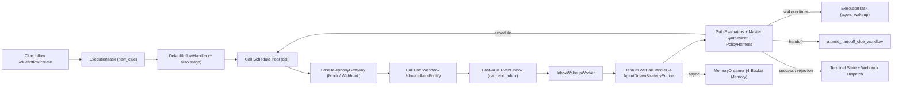

# Architecture Overview

## End-to-End Flow

## Key Subsystems

- **Adaptive Tiered Engine (`project/app/strategy/agent_driven/engine.py`)**: Tier 0 zero-LLM physical short-circuit for unanswered calls -> Tier 1 `single_pass` (`ClueSupervisorAgent` + `ToolBus`) or Tier 2 `map_reduce` -> Tier 3 `PolicyHarness` + 5s `HeuristicSafetyFallbackEngine`.
- **Business Cartridges (`project/app/agents/domain_registry.py`)**: YAML definitions in `project/app/domains/` overridden dynamically by `WorkflowDomainConfig` rows in DB, including `in_call_flow` nodes and configurable working windows.
- **Tool Isolation & Deferred Approval (`project/app/agents/tool_bus.py` & `approvals.py`)**: `PydanticAI` toolsets filtered per business domain with SSRF-protected `DeclarativeHttpToolFactory`, `CredentialProxy`, and `AWAITING_APPROVAL` suspend/resume flow.
- **Unified Event Inbox & Coalescing (`project/app/agents/inbox_worker.py`)**: Coalesces `call_end_inbox`, `agent_wakeup`, `channel_inbox`, `approval_resumed`, and `memory_dream` tasks per clue.
- **Pluggable Gateways (`project/app/apis/telephony.py`)**: Supports `MockTelephonyGateway`, `GenericWebhookGateway`, `LiveKitTelephonyGateway`, and `PipecatTelephonyGateway`, all injecting rendered `memoryIndex` & `dynamicInstruction`.
- **Transactional Tasks (`ExecutionTask`)**: Unified outbox/inbox table for `import`, `new_clue`, `call`, `call_end_inbox`, `agent_wakeup`, `channel_inbox`, `tool_approval`, `approval_resumed`, `webhook`, and `internal_event`.
