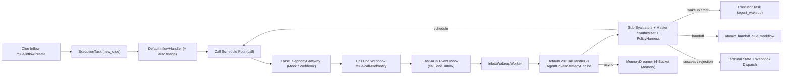

# Architecture Overview

## End-to-End Flow

## Key Subsystems

- **Business Cartridges (`project/app/agents/domain_registry.py`)**: YAML definitions in `project/app/domains/` overridden dynamically by `WorkflowDomainConfig` rows in DB.
- **Tool Isolation (`project/app/agents/tool_bus.py`)**: `PydanticAI` toolsets filtered per business domain with SSRF-protected `DeclarativeHttpToolFactory` and `CredentialProxy`.
- **Transactional Tasks (`ExecutionTask`)**: Unified outbox/inbox table for `import`, `new_clue`, `call`, `call_end_inbox`, `agent_wakeup`, `webhook`, and `internal_event`.
